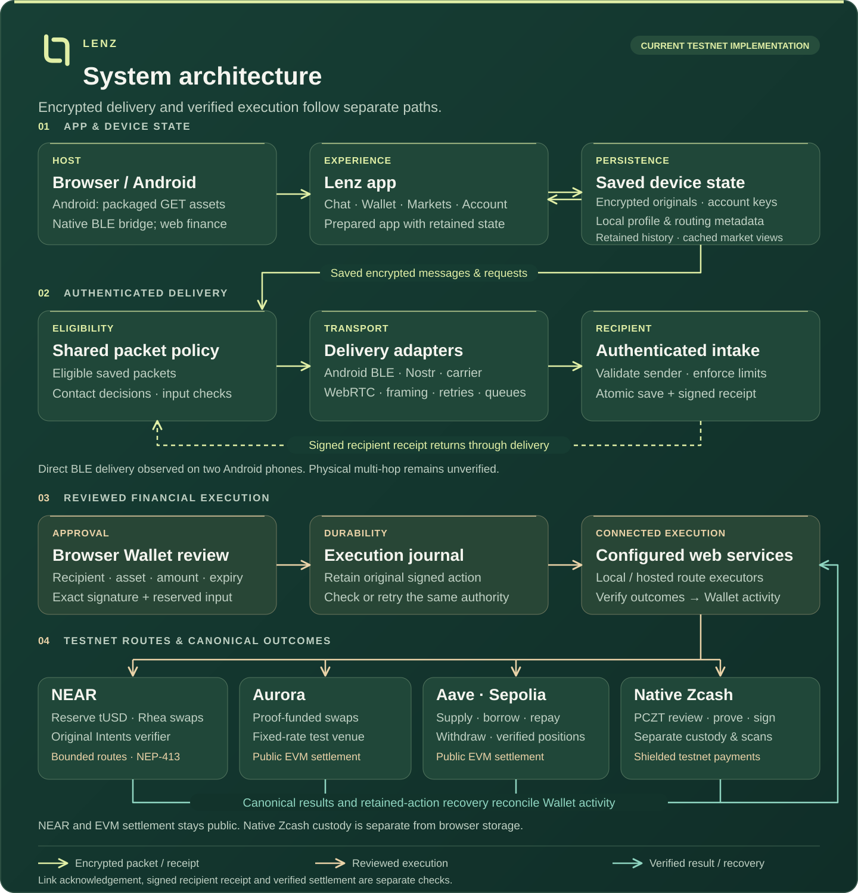

<p align="center">
  <a href="https://lenz-prototype.vercel.app"></a>
</p>

<p align="center">
  <a href="contracts/README.md"></a>
  <a href="zcash/pczt.md"></a>
  <a href="contracts/Cargo.toml"></a>
  <a href="web/README.md"></a>
  <a href="research/offline-social-live.md"></a>
  <a href="LICENSE"></a>
</p>

<p align="center">
  <a href="https://lenz-prototype.vercel.app">Experience</a> ·
  <a href="#what-works-today">Capabilities</a> ·
  <a href="#architecture">Architecture</a> ·
  <a href="#integration-evidence">Integrations</a> ·
  <a href="#local-setup">Local setup</a> ·
  <a href="#hosting">Hosting</a> ·
  <a href="#tests-and-evidence">Verification</a> ·
  <a href="#development-and-license">Authorship</a>
</p>

Lenz is a private messaging and DeFi app built for unreliable internet. It brings encrypted conversations and reviewed financial actions into one place, so losing a connection does not have to mean losing the conversation or starting a request again.

Its goal is to make private messaging and private offline DeFi usable without a continuous internet connection. Today's prototype keeps encrypted message history, cached market information and prepared requests available offline. Prepared Android devices can exchange encrypted messages over Bluetooth LE. Supported payments, swaps and lending actions use connected testnet services to execute and verify their outcomes.

[Live testnet prototype](https://lenz-prototype.vercel.app) · [Current implementation](docs/implementation-status.md) · [Tests and evidence](docs/testing.md) · [Local setup](#local-setup)

Test assets have no cash value. An offline message receipt confirms arrival; a payment or DeFi action needs its separate verified blockchain outcome. The hosted prototype depends on configured local execution services.

## The problem

An interrupted connection can leave two questions unanswered: did the other person receive the message, and did the payment actually complete? Recreating a financial request can change its terms or create a second obligation. A cached balance or a saved confirmation screen cannot establish whether a blockchain action succeeded.

Lenz keeps the original encrypted message or reviewed financial instruction with its pending state. It distinguishes a message reaching its recipient from money settling on a blockchain. Nearby delivery can carry conversations between prepared Android devices without mobile data; connected recovery checks or retries the original financial action and records the verified result.

## Using Lenz

| What you want to do | How Lenz handles it today |
| --- | --- |
| Talk privately with someone | Exchange signed, encrypted messages. Adding a contact queues a message request; the recipient can Accept or Decline. |
| Keep talking when mobile data drops | Enable Nearby on prepared Android devices and keep Lenz open. Bluetooth LE carries the encrypted messages; the recipient's signed receipt confirms arrival. |
| Check information while offline | Reopen the prepared app, read retained message history and view cached market snapshots. Live prices and blockchain balances need a connection. |
| Prepare a supported payment or swap | Review the destination, asset and amount. Lenz retains the original signed request and reserved input for the supported route; connected execution confirms the outcome. |
| Find out what happened to an interrupted action | Use the route's activity and recovery controls to check the recorded action or retry its original instruction. A pending result stays unresolved until verification. |

## What works today

| Area | Available today | Tested boundary |
| --- | --- | --- |
| Conversations and contacts | Send encrypted messages, receive automatic message requests, Accept/Decline and see arrival receipts | Browser/WebSocket and simulated native transport checks; request discovery exposes routing IDs and public keys |
| Offline access | Use the cached app, read retained encrypted history, consult saved market snapshots and keep prepared requests for exact retries | Requires a prepared app and retained account state. Chat drafts last only while the page remains open; fresh blockchain reads and settlement need connectivity |
| Android Nearby | Send messages directly over Bluetooth LE, with fragmentation, bounded forwarding and stored retries | Direct Samsung ↔ Xiaomi delivery observed; reverse delivery took about 20 seconds in the retry check. Multi-hop remains unverified |
| NEAR payments and Rhea swaps | Send funded tUSD, pass backed value onward and swap through the bounded Rhea route | Recorded testnet transactions; November 17 hosted protocol swap needed three operator advances after the sponsor limit. Offline acceptance remains provisional |
| NEAR Intents | Swap through the Wallet's route using the original NEP-413 verifier, with token-change and output checks | Recorded 1 LTS → 2 LTT testnet swap; 1Click partner execution is separate and unverified |
| Aurora swaps | Review and sign a proof-funded Wallet swap, then check its receipt and reconcile the saved action | Recorded fixed-rate test venue; live interrupted-submission recovery, broader asset routes and private settlement remain unverified |
| Aave lending on Sepolia | Review Supply, Borrow, Repay, Withdraw and transfer actions; inspect activity and recovery | Recorded Aave testnet operations; indexed residual collateral remained after exits |
| Shielded Zcash payments | Send from Wallet through local PCZT review, proving and signing, then check the canonical wallet outcome | Recorded shielded testnet payment; browser backups do not restore native spending keys |
| Markets | Browse public market data, charts and catalogues, with cached snapshots for offline reference | Hyperliquid funded trading and general liquidity/yield execution remain unfinished |

The [implementation table](docs/implementation-status.md) links each behavior to its code, verification commands and limitations. General private offline DeFi, never-online first use, iOS, production recovery and physical multi-hop are unfinished. The Android package has no financial API backend; funding and settlement use the configured hosted web services.

## Architecture

<p align="center"></p>

[Full-size SVG](brand/architecture.svg) · [Detailed architecture and delivery flow](docs/architecture.md) · [Financial source map](docs/evidence/SOURCE-MAP.md)

Chat and Wallet share the Lenz identity and retained device state. Message transports carry the original encrypted packets into authenticated intake, which saves the result and a signed arrival receipt together. Financial routes retain their own signed authority and journals, then use configured connected executors and separate blockchain verification. The Android host provides the packaged app and BLE bridge; execution services retain separate operator or native wallet custody.

## Implementation map

| Directory | Responsibility |
| --- | --- |
| [web/](web/README.md) | Browser UI, encrypted storage, delivery clients, account backup, service workers and hosted execution routes |
| [native/android/](native/android/README.md) | Android WebView host and original Lenz BLE transport |
| [contracts/](contracts/README.md) | NEAR reserve, Rhea adapter and pinned original Intents verifier deployment |
| [aurora/](aurora/README.md) | Solidity execution accounts, proof-funded swaps, lending contracts and Engine codecs |
| [integrations/](integrations/README.md) | Provider adapters, catalogues, quotes and testnet intent workflows |
| [zcash/](zcash/README.md) | Native shielded payment review, PCZT execution and canonical outcome checks |
| [carrier/](carrier/README.md) | Encrypted transport storage and separate DeFi executor protocols |
| [docs/](docs/status.md) | Current scope, privacy/recovery boundaries and dated implementation reports |

The [architecture guide](docs/architecture.md) follows storage, shared delivery policy, native transport and connected execution through their source modules. The web app uses JavaScript, WebCrypto, IndexedDB, Web Locks, service workers, WebRTC and Nostr. Node.js serves the app and execution journals. NEAR contracts use Rust; Aurora/Sepolia contracts use Solidity. Zcash uses pinned native Rust tooling. Proof tooling includes Circom, snarkjs and the original Tornado circuit.

## Integration evidence

<p align="center"></p>

[Recorded Wallet](web/evidence/wallet-desktop.png) · [Recorded Chat](web/evidence/private-chat-desktop.png) · [Recorded Trading](web/evidence/trade-desktop.png). These earlier development captures are preserved; Chat now uses automatic delivery and message requests. The current implementation table describes the changed behavior.

The [evidence index](docs/evidence/README.md) contains dated, machine-readable summaries of actual NEAR reserve, Rhea, Intents, Aurora, Zcash and Aave transactions, plus the two-phone Bluetooth observations. Each summary separates the original observation from current implementation hashes. The [source map](docs/evidence/SOURCE-MAP.md) follows the mounted UI through authority, execution and result checks.

This is testnet evidence for the recorded paths. Fixture success, configured endpoints and installed SDKs do not establish a new transaction. Encryption of chat or an approval does not make its public blockchain settlement private. [Addresses, hosting and privacy boundaries](docs/testnet-integrations.md).

## Tests and evidence

The [testing record](docs/testing.md) lists dated results, reproduction commands and remaining limits for startup, delivery, contact requests, recovery, offline restart, markets, Android transport and financial integrations. November 17 checks include 39 startup tests, the same 50 delivery/contact tests before and after the refactor, and cache graphs of 881 Chat routes and 880 app routes. Migrated carrier, Nostr and WebRTC browser harnesses passed 11, ten and eight groups respectively. Separate evidence records the two-phone messages and eight finalized payment/swap transactions. The record retains the Bluetooth delay, sponsor-limit recovery and earlier harness failures; it does not claim a full-repository test pass.

## Local setup

Use Node.js 24 or newer. Install the existing locked dependency scopes from the repository root:

```sh
git clone https://github.com/captainbishop/lenz.git
cd lenz
npm ci --ignore-scripts --no-audit --no-fund
npm --prefix contracts ci --ignore-scripts --no-audit --no-fund
npm --prefix aurora ci --ignore-scripts --no-audit --no-fund
npm --prefix integrations ci --ignore-scripts --no-audit --no-fund
npm --prefix web/near-connector ci --ignore-scripts --no-audit --no-fund
npm --prefix integrations/quote-verifier ci --ignore-scripts --no-audit --no-fund
npm run prepare:web
npm run check
npm run check:offline
npm start
```

Open the loopback address printed by the server. Without service configuration, the frontend opens while funded execution is unavailable. `prepare:web` downloads only eleven approved public bootstrap files and verifies their pinned hashes; it preserves the existing proving parameters. Rust and native wallet tooling are required for their component builds, not frontend startup.

Microsoft Edge is required by the selected Playwright browser tests:

```sh
npm run test:browser
npm run test:requests
```

These commands use disposable identities and fixture transport boundaries. They do not submit a financial transaction. Component-specific verification commands are in the [implementation table](docs/implementation-status.md).

## Hosting

`npm run build:hosted` creates a fresh `.vercel-package` and refuses an existing output directory. The root [Vercel configuration](vercel.json) uses the same pinned asset preparation before packaging. Packaging alone provides static pages; configured execution routes need the authenticated gateway and retained custody/journals described in [backend and hosting setup](docs/testnet-integrations.md#hosting).

The Android APK build uses an explicit packaged public directory, Android platform/build tools and JDK. Follow [native build instructions](native/android/README.md); keep its output and signing key outside the repository.

## Development and license

Preserve identities, keys and pending obligations. Use factual verification dates and distinguish fixture results from live execution and physical transport. [Contributing](CONTRIBUTING.md) · [Security](SECURITY.md) · [Code of conduct](CODE_OF_CONDUCT.md) · [Detailed development history](docs/status.md).

Created and maintained by [captainbishop](https://github.com/captainbishop), Lenz's sole project author. Original project code is available under the [MIT license](LICENSE). Third-party code retains its licenses and [notices](THIRD_PARTY_NOTICES.md). The Android transport is original Lenz Java code informed by pinned Bitchat techniques; its Lenz wire protocol does not interoperate with Bitchat clients. Proof of U remains the protocol/research namespace for compatibility.
