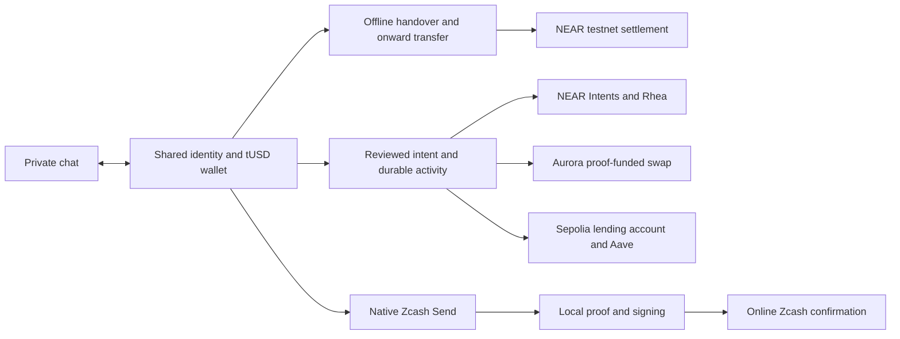

<p align="center">
  
</p>

<p align="center">
  <a href="contracts/README.md"></a>
  <a href="zcash/pczt.md"></a>
  <a href="contracts/Cargo.toml"></a>
  <a href="web/README.md"></a>
  <a href="research/offline-social-live.md"></a>
  <a href="LICENSE"></a>
</p>

<p align="center">
  <a href="#experience">Experience</a> ·
  <a href="#capabilities">Capabilities</a> ·
  <a href="#architecture">Architecture</a> ·
  <a href="#integrations">Integrations</a> ·
  <a href="#local-setup">Local setup</a> ·
  <a href="#hosting">Hosting</a> ·
  <a href="#verification">Verification</a> ·
  <a href="#authorship-and-license">Authorship</a>
</p>

Lenz brings private conversations, payments and DeFi into one web app. Start online, prepare an action, and retain your account, messages and pending requests when the connection drops.

Send a payment from a chat or your wallet. The recipient can use it to pay someone else while both of you remain offline. Reconnect when you can to settle payments or review and execute saved swaps. Your conversations, contacts and wallet stay under one profile.

> **Testnet prototype.** Use test assets only. Saved requests and delivery receipts remain separate from blockchain settlement. The final original-account Swap, native Send and lending-exit checks are separate from component tests. [Current addresses and integration scope](docs/testnet-integrations.md) · [development status](docs/status.md).

## Experience

<p align="center"></p>

| Screen | Purpose |
| --- | --- |
| `/` | Lenz homepage and product overview |
| `/chat.html` | Private conversations, contacts and tUSD payment handover |
| `/money.html` | Standalone wallet, received payments and saved swaps |
| `/markets.html` | Market data, lending accounts and action reviews |
| `/account.html` and `/recovery.html` | Account creation, encrypted backup and original-request recovery |
| `/zcash-lab.html` | Separate native Zcash accounts, read/sync and unsigned payment review |
| `/wallet-lab.html` and `/swap-tools.html` | Developer signing, recovery and transaction diagnostics |

Screenshots are recorded development views. [Wallet](web/evidence/wallet-desktop.png) · [Chat](web/evidence/private-chat-desktop.png) · [Trading](web/evidence/trade-desktop.png). [Open the live prototype](https://lenz-prototype.vercel.app), [run locally](#local-setup) or follow the [hosting setup](#hosting).

## Capabilities

- Exchange encrypted messages and contact cards with names and avatars.
- Prepare and receive payments offline, then pass received value onward without a local validator group.
- Use chat or the standalone wallet without creating a separate financial identity.
- Settle signed tUSD payments on NEAR testnet and execute bounded Rhea swaps when connected.
- Keep saved swaps reserved on reconnect; reconnection never starts them automatically.
- Use the original NEAR Intents verifier with signed token changes and verified output withdrawal on testnet.
- Review Aurora proof-funded Swap and Sepolia lending actions with exact account/amount bounds and durable activity.
- Review native shielded Zcash payments through Wallet → Send with a configured local native signer and retained Activity.

Offline acceptance is provisional. A copied wallet can create conflicting authorizations; local validation does not guarantee that every competing claim will redeem. A name or avatar is a label, not authentication. [Behavior and safety boundaries](docs/behavior.md).

## Architecture



The browser uses JavaScript modules, WebCrypto, IndexedDB, Web Locks, service workers and WebRTC. Node.js serves the app and execution journals. NEAR contracts use Rust; Aurora/Sepolia contracts use Solidity. Zcash uses pinned native Rust tooling and PCZTs. Proof tooling includes Circom, snarkjs and the original Tornado circuit. Native Zcash custody is a separate account boundary from the NEAR reserve. [Privacy and recovery boundaries](docs/testnet-integrations.md).

## Integrations

| Component | Verified | Still open |
| --- | --- | --- |
| NEAR reserve | Testnet funding, settlement, conflict rejection and backed deposits | Private settlement, safe recovery and broader device coverage |
| Rhea | Signed swaps, exact payouts/refunds, offline re-entry and bounded redemption recovery | External NEAR signing and other missing-callback recovery |
| Native Zcash | Confirmed ordinary Wallet → Send testnet transfer; local PCZT proving/signing, canonical receipt checks and retained Activity | Native custody recovery/rescan and broader failure coverage; browser archives preserve action references |
| NEAR Intents | Original verifier deployed on testnet, owner-issued LTS/LTT assets, NEP-413 signatures and atomic token changes | This route uses a testnet solver; 1Click partner access is a separate unavailable integration |
| Aurora | Ordinary Wallet Swap finalized for 1 LTS→2 LTT, with NEAR/Aurora receipts, exact action/event checks and encrypted archive restoration offline using the same key | Broader asset routes and interrupted-submission recovery; the recorder aborted a background market read after financial success |
| Aave lending | Sepolia LINK collateral/test USDC debt, bounded Supply/Borrow/Repay/Withdraw/transfer and durable recovery | Original repayment and free-fund exits finalized; residual indexed collateral remains |
| Tornado | Original v2.1 circuit/prover and verifier used for fixed-denomination pool membership proofs | Limited test-pool anonymity; recipient, amounts and later DeFi activity remain public |
| Hyperliquid | Browseable charts/markets and shared Coming soon dialog | Funded trading execution remains unverified |

[NEAR contracts](contracts/README.md) · [Rhea adapter](contracts/adapter/README.md) · [Zcash evidence](zcash/pczt.md) · [Payment review](zcash/payment-review.md) · [Aurora scope](aurora/README.md) · [development status](docs/status.md).

## Local setup

Use Node.js 24 or newer. Windows Edge is the browser used for the recorded tests. Rust and the native Zcash toolchain are needed for their respective integration tests, not for inspecting the source.

```sh
git clone https://github.com/captainbishop/lenz.git
cd lenz
npm --prefix contracts ci --ignore-scripts --no-audit --no-fund
npm --prefix aurora ci --ignore-scripts --no-audit --no-fund
cd research/crypto-step
npm ci --ignore-scripts --no-audit --no-fund
npm run build
cd ../../web
node build.mjs
node server.mjs
```

Open [Lenz locally](http://localhost:4173/), using the same origin as configured local execution services. The proof build creates **test-only** parameters; it can take several minutes. Fresh setup keys differ from saved evidence. Follow [proof build instructions](research/crypto-step/README.md), [web setup](web/README.md) and [backend configuration](docs/testnet-integrations.md#backend-setup). Native executables, wallet keys, scans, original proving artifacts and private PCZTs stay outside Git.

Unconfigured services report unavailable rather than accepting financial requests. Live execution requires separately funded disposable test accounts, pinned deployments and durable journals. Keep the same journal and sponsor through restart. Do not repeat deployments or faucet requests as setup checks.

Physical Bluetooth mesh, the never-online first-use journey, complete forward secrecy and production recovery remain further work.

## Hosting

Choose the package for the intended backend:

| Package | Build command from the repository root | Backend |
| --- | --- | --- |
| Static preview | `node web/build-vercel.mjs /absolute/path/to/a/new/preview-directory` | APIs return HTTP 503 `BACKEND_UNAVAILABLE` |
| Connected Vercel app | `node web/build-hosted-vercel.mjs /absolute/path/to/a/new/connected-directory` | Authenticated server proxy to a separately configured private gateway |

The [live prototype](https://lenz-prototype.vercel.app) serves the website and API proxy on Vercel. The proxy reaches this computer's authenticated local gateway through a temporary Cloudflare tunnel; availability depends on those local services. Signing keys, native wallets and execution journals stay on the operator's computer. Existing Lenz identity sign-in and an explicit source/owner mapping limit financial routes. Public pages, NEAR reserve reads and the configured access boundaries have passed read-only checks; real financial execution through the public origin remains separate. [Environment and gateway setup](docs/testnet-integrations.md#hosting).

The Vercel project is connected to this GitHub repository. Its root configuration
runs `npm ci --prefix web/near-connector` and `node web/build-git-vercel.mjs`.
The build verifies the pinned hashes in `web/git-public-assets.json` before
using public bootstrap assets; it preserves the existing test proving parameters.

## Verification

Run the local regression checks from the repository root:

```sh
node --test web/server-integration.test.mjs web/build-vercel.test.mjs
node --test web/intent-near-relay.test.mjs web/intent-lending-read.test.mjs web/intent-zcash-recovery.test.mjs
node web/verify-chat-static.mjs
node tooling/check-freshness.mjs
```

The [funded social flow](research/offline-social-live.md) records actual tUSD funding, offline A → B → C handover and online settlement/Rhea execution. The [Zcash flow](zcash/pczt.md) records a separate native shielded payment. Fixture tests, saved-evidence checks and live chain observations are identified separately in each report.

`node zcash/verify-pczt.mjs` also checks locally built executable hashes, so it needs the pinned native tooling. Source-only clones do not contain those binaries. Never run a transaction script merely to check that the repository works.

## Development

Work in small, reviewable changes. Preserve existing identities, keys, contacts and pending financial obligations. Record the checks run and retain unresolved failures. [Contributing](CONTRIBUTING.md) · [Code of conduct](CODE_OF_CONDUCT.md) · [Security](SECURITY.md) · [Development status](docs/status.md).

## Authorship and license

Created and maintained by [captainbishop](https://github.com/captainbishop), Lenz's sole project author. Original project code is available under the [MIT license](LICENSE). Third-party software and source material retain their own licenses and notices; see [third-party notices](THIRD_PARTY_NOTICES.md).

Proof of U remains the protocol and research namespace for compatibility.
