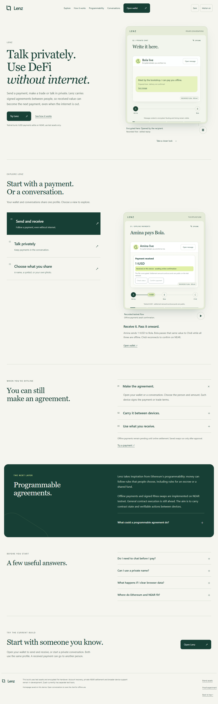
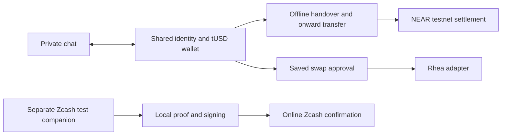

<p align="center">
  
</p>

<p align="center">
  <a href="contracts/README.md"></a>
  <a href="zcash/pczt.md"></a>
  <a href="contracts/Cargo.toml"></a>
  <a href="web/README.md"></a>
  <a href="research/offline-social-live.md"></a>
  <a href="LICENSE"></a>
</p>

<p align="center">
  <a href="#experience">Experience</a> ·
  <a href="#capabilities">Capabilities</a> ·
  <a href="#architecture">Architecture</a> ·
  <a href="#integrations">Integrations</a> ·
  <a href="#local-setup">Local setup</a> ·
  <a href="#verification">Verification</a> ·
  <a href="#authorship-and-license">Authorship</a>
</p>

Lenz brings private conversations, payments and DeFi into one app that keeps working without a reliable internet connection.

Send a payment from a chat or your wallet. The recipient can use it to pay someone else while both of you remain offline. Reconnect when you can to settle payments or review and execute saved swaps. Your conversations, contacts and wallet stay under one profile.

> **Testnet development.** The offline tUSD flow and a native shielded Zcash payment have live evidence. Private NEAR settlement, account recovery and the Zcash product interface remain in progress. Use test assets only. [What works today](#integrations) · [development status](docs/status.md).

## Experience

<p align="center"></p>

| Screen | Purpose |
| --- | --- |
| `/` | Lenz homepage and product overview |
| `/chat.html` | Private conversations, contacts and tUSD payment handover |
| `/money.html` | Standalone wallet, received payments and saved swaps |
| `/zcash-lab.html` | Separate native Zcash accounts, read/sync and unsigned payment review |
| `/wallet-lab.html` and `/swap-tools.html` | Developer signing, recovery and transaction diagnostics |

Screenshots are recorded development views. There is no hosted public demo yet. [Run locally](#local-setup) to use the app; the earlier synthetic payment experiment remains under **Earlier prototype**.

## Capabilities

- Exchange encrypted messages and contact cards with names and avatars.
- Prepare and receive payments offline, then pass received value onward without a local validator group.
- Use chat or the standalone wallet without creating a separate financial identity.
- Settle signed tUSD payments on NEAR testnet and execute bounded Rhea swaps when connected.
- Keep saved swaps reserved on reconnect; reconnection never starts them automatically.
- Prove and sign a native shielded Zcash transaction locally, then submit and confirm it online through the developer tools.

Offline acceptance is provisional. A copied wallet can create conflicting authorizations; local validation does not guarantee that every competing claim will redeem. A name or avatar is a label, not authentication. [Behavior and safety boundaries](docs/behavior.md).

## Architecture



The Zcash companion is a separate test account boundary. It is not a shielded wrapper around the NEAR reserve. The full private settlement relation and a supported ZEC↔DeFi value route remain active engineering work. [Behavior and safety boundaries](docs/behavior.md).

## Integrations

| Component | Verified | Still open |
| --- | --- | --- |
| NEAR reserve | Testnet funding, settlement, conflict rejection and backed deposits | Private settlement, safe recovery and broader device coverage |
| Rhea | Signed swaps, exact payouts/refunds, offline re-entry and bounded redemption recovery | External NEAR signing and other missing-callback recovery |
| Native Zcash | Confirmed 0.1-test-ZEC shielded transfer, local PCZT proving/signing, plus browser review of actual unsigned payments | Product signing approval, restore/rescan, submission recovery and ZEC↔DeFi route |
| NEAR Intents | SDK integration, empty-intent authentication and local quote-signature checks | Partner API access and a supported funded execution route |
| Aurora | Local EVM tooling and proof-verifier experiments | Lenz deployment and a defined NEAR↔Aurora asset route |

[NEAR contracts](contracts/README.md) · [Rhea adapter](contracts/adapter/README.md) · [Zcash evidence](zcash/pczt.md) · [Payment review](zcash/payment-review.md) · [Aurora scope](aurora/README.md) · [development status](docs/status.md).

## Local setup

Use Node.js 24 or newer. Windows Edge is the browser used for the recorded tests. Rust and the native Zcash toolchain are needed for their respective integration tests, not for inspecting the source.

```sh
git clone https://github.com/captainbishop/lenz.git
cd lenz/research/crypto-step
npm ci --ignore-scripts --no-audit --no-fund
npm run build
cd ../../web
node build.mjs
node server.mjs
```

Open [Lenz locally](http://127.0.0.1:4173/). The proof build creates **test-only** parameters; it can take several minutes. Fresh setup keys differ from the saved evidence. Follow [proof build instructions](research/crypto-step/README.md) and [web setup](web/README.md) for details. Native executables, wallet keys and private PCZTs are deliberately excluded from this repository.

The read-only source and static screens do not require funding. Live sponsor/wallet operations require separately configured disposable test accounts. Do not repeat deployments or faucet requests as setup checks. This first commit includes development test failures and public testnet receipts alongside the implementation.

## Verification

Run the local regression checks from the repository root:

```sh
node --test zcash/companion.test.mjs web/zcash-relay.test.mjs web/defi-relay.test.mjs
node web/verify-chat-static.mjs
node tooling/check-git-content.mjs
```

The [funded social flow](research/offline-social-live.md) records actual tUSD funding, offline A → B → C handover and online settlement/Rhea execution. The [Zcash flow](zcash/pczt.md) records a separate native shielded payment. Fixture tests, saved-evidence checks and live chain observations are identified separately in each report.

`node zcash/verify-pczt.mjs` also checks locally built executable hashes, so it needs the pinned native tooling. Source-only clones do not contain those binaries. Never run a transaction script merely to check that the repository works.

## Development

Work in small, reviewable changes. Preserve existing identities, keys, contacts and pending financial obligations. Record the checks run and retain unresolved failures. [Contributing](CONTRIBUTING.md) · [Code of conduct](CODE_OF_CONDUCT.md) · [Security](SECURITY.md) · [Development status](docs/status.md).

## Authorship and license

Created and maintained by [captainbishop](https://github.com/captainbishop), Lenz's sole project author. Original project code is available under the [MIT license](LICENSE). Third-party software and source material retain their own licenses and notices; see [third-party notices](THIRD_PARTY_NOTICES.md).

Proof of U remains the protocol and research namespace for compatibility.
