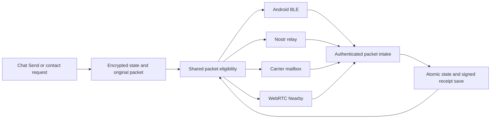
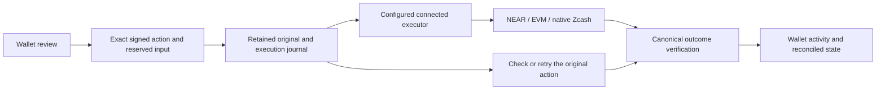

# Repository architecture

Lenz separates browser state, message delivery, connected execution and blockchain verification. The [current implementation](implementation-status.md) records supported paths and limits; the [transaction source map](evidence/SOURCE-MAP.md) follows financial actions through their mounted code.

## Code ownership

| Location | Responsibility | Start here |
| --- | --- | --- |
| `web/public/` | Screens, encrypted account storage, original requests, transport clients and offline cache | [Chat](../web/public/chat.js), [Wallet](../web/public/money.js), [Markets](../web/public/markets.js), [Account](../web/public/account-ui.js) |
| `web/` | HTTP routes, execution journals, provider adapters, packaging and behavioral tests | [Local server](../web/server.mjs), [hosted gateway](../web/hosted-gateway.mjs), [web guide](../web/README.md) |
| `api/` | Vercel entry point for the authenticated hosted proxy | [Proxy](../api/proxy.mjs), [route policy](../web/hosted-policy.mjs) |
| `native/android/` | Packaged WebView, origin-bound bridge and foreground BLE transport | [Native host](../native/android/src/app/lenz/nearby/MainActivity.java), [radio transport](../native/android/src/app/lenz/nearby/BluetoothMesh.java), [build guide](../native/android/README.md) |
| `contracts/` | NEAR reserve, Rhea adapter and source-pinned upstream Intents verifier | [Contracts](../contracts/README.md), [adapter](../contracts/adapter/README.md), [Intents](../contracts/intents-testnet/README.md) |
| `aurora/` | Solidity authorization/execution accounts, lending and NEAR Engine encoding | [Contracts and execution](../aurora/README.md) |
| `integrations/` | Provider catalogues, quotes and testnet integration protocols | [Integration guide](../integrations/README.md) |
| `zcash/` | Native PCZT review, proving/signing, submission and canonical wallet observation | [Native payment guide](../zcash/README.md) |
| `carrier/` | Separately operated encrypted mailboxes and connected DeFi executors | [Carrier guide](../carrier/README.md) |
| `research/` | Retained specifications, original proof experiment, dependency reports and dated verification | [Technical material](../research/README.md), [proof build](../research/crypto-step/README.md) |
| `tooling/` | Developer startup, source freshness and component build/check commands | [Root commands](../package.json), [freshness gate](../tooling/check-freshness.mjs) |
| `brand/` | Product marks, repository banner and visual assets | [Brand guide](../brand/README.md) |
| `docs/` | Curated behavior, integration limits, setup and dated evidence | [Current implementation](implementation-status.md), [evidence index](evidence/README.md) |

Browser tests live beside the Node routes in `web/` and end in `.test.mjs` or `-browser.test.cjs`. Contract and integration checks live with their implementations. Fixtures simulate specific external boundaries; their success does not establish deployed execution.

## Message delivery

[Delivery mode](../web/public/delivery-mode.js) records requested delivery. [Shared packet policy](../web/public/delivery-packets.js) checks contact decisions, payment eligibility and consumed inputs. [Packet intake](../web/public/receive-packet.js) authenticates the sender, enforces request and storage limits, retains original ciphertext and prepares the [signed recipient receipt](../web/public/delivery-receipts.js). Transport clients retain their own framing, session, cancellation and queue checks. Callers save intake and receipt changes together through [the encrypted state store](../web/public/chat-store.js).

A GATT or relay acknowledgement confirms transport progress. The intended recipient's signed receipt marks arrival. Financial outcomes need separate canonical verification.

## Financial execution

The browser holds the Lenz identity and reviewed action. Each execution route enforces its own owner, asset, amount, recipient, nonce and expiry rules. Configured services hold separate testnet operator/native custody and journals. [Financial recovery](financial-recovery.md) describes unresolved actions and retained liabilities.

The Android host serves packaged GET assets and its BLE bridge. It has no financial POST backend. Connected financial execution uses the configured hosted or local web services. Wallet payment and swap file handovers remain available; ordinary Chat messages use direct delivery. Broader private offline DeFi and physical multi-hop remain unfinished.

## Builds and retained state

[Asset preparation](../web/prepare-public-assets.mjs) verifies pinned bootstrap files. [Hosted packaging](../web/build-hosted-vercel.mjs) creates the web/proxy release; [Android packaging](../native/android/build.mjs) takes an explicit public asset snapshot. The [app](../web/public/sw.js) and [chat](../web/public/chat-sw.js) service workers cache stable public URLs. New browser modules must be included in both applicable cache graphs and verified before publication.

Public URLs and storage formats are compatibility surfaces. Retained identities, encrypted originals, pending authorizations and native custody use their existing recovery paths. Older screenshots and recordings keep their original evidence dates.
