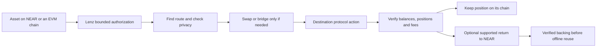

# Cross-chain DeFi in Lenz

Lenz is being built as a cross-chain DeFi aggregator with private conversations,
offline authorization and offline onward payments. A protocol or chain is an
execution destination, not the product boundary. The current public Rhea
testnet swap is the first connected adapter; it does not define the supported
scope of the finished product.

Every screen follows the [Lenz design standard](interface-design.md). Market,
perpetuals, yield, chat and recovery interfaces need their own appropriate
compositions within one recognizable identity.

## Product scope

| Area | Actions to support | Position or result to verify |
| --- | --- | --- |
| Spot markets | Swap, limit orders, cross-chain acquisition, speculative/new-token trading where a supported route exists | Exact token, chain, received amount, remaining order and fees |
| Liquidity | Add/remove liquidity, concentrated ranges, collect fees, migrate positions | Pool, both assets, range, position ownership and actual withdrawals |
| Credit | Supply, withdraw, collateral changes, borrow, repay, refinance | Collateral, debt, interest, permissions and health/liquidation state |
| Yield | Staking, unstaking, liquid staking/restaking, farming, vault deposits/withdrawals and reward claims | Shares, underlying assets, rewards, lockups and exit queue |
| Derivatives | Hyperliquid and other supported venues: perpetuals/margin, order placement/modification/cancellation, collateral, reduce/close and withdrawal | Venue account, fills, open orders, margin, leverage, funding and liquidation state |
| Further strategies | Options, structured positions and additional protocol actions through reviewed adapters | The protocol-specific asset/position effects and exit/recovery path |

This is an extensible scope, not a claim that every protocol or action is already
integrated. Discovery, quoting, authorization, execution, position tracking and
exit support must be recorded separately. A functioning deposit does not prove
withdrawal or liquidation management works.

## Reach liquidity where it lives

Suppose a token's liquidity exists on a Uniswap pool on Base. Lenz should find
and execute against that pool through a verified direct or aggregator route.
Funds already on Base can stay there. If the spendable asset starts on NEAR,
the planner must connect a supported NEAR-to-Base funding route to the actual
swap. A user holding an Aave position on Arbitrum should manage that position
on Arbitrum; it need not move to Aurora or NEAR first.

Illustrative flow; the exact asset pair and providers still need live verification:

One user-reviewed objective can cover several chain steps. It does not make
the whole cross-chain flow atomic. Each leg needs its own durable state,
finality check, balance accounting and recovery. If the bridge completes but
the destination call fails, Lenz must locate and recover the intermediate
funds instead of reporting success or releasing the original reservation.

A token available on an EVM chain is not automatically a transferable token on
NEAR or an offline Lenz note. A supported representation, conversion or reserve
is required. Existing testnet tUSD cannot fund a mainnet route.

## Provider and execution layers

The router should compare eligible providers against the approved outcome,
total fees, minimum result, time, reliability and privacy. It must not force
every operation through Rhea, Aurora or one bridge. Provider fallback stays
inside the signed constraints; a confidentiality downgrade requires a new
decision, not an automatic retry.

| Component | Candidate responsibility | Evidence and limits |
| --- | --- | --- |
| Rhea | NEAR markets and eligible cross-chain swap/lending routes | Its [cross-chain API](https://github.com/rhea-finance/rhea-sdk-docs/blob/main/CrossChainDexAPI.md) documents NEAR/EVM and other families, aggregator routes and confidential swaps. This is broader than Lenz's current adapter. Exact pools, assets, access and outputs need verification. |
| LI.FI / Jumper-style aggregation | Discover and compose routes across liquidity sources, bridges and destination actions | [LI.FI](https://docs.li.fi/introduction/introduction) documents routing across these systems. [Composer](https://docs.li.fi/composer/overview) bundles supported EVM actions, including protocol calls and deposits. Same-chain atomicity must not be generalized to an entire cross-chain journey. |
| LI.FI Earn or direct protocol adapters | Yield/credit discovery, deposits and position data | [Earn](https://docs.li.fi/earn/overview) explicitly lists Aave, Morpho, Euler and Pendle among its coverage. Indexed vault coverage is incomplete; destination and withdrawal support must be checked independently. |
| Hyperliquid, directly or through a venue SDK | Perpetuals, margin, spot/position/order management and exits | [LI.FI Perps](https://docs.li.fi/perps/overview) explicitly includes Hyperliquid and normalizes venue operations; it is not a best-price router. Its endpoint needs separately granted access. Agent-wallet authority must be reviewed before adoption. |
| Relay | Eligible cross-chain funding, swaps and destination calls | [Relay](https://docs.relay.link/what-is-relay) documents these capabilities. A specific NEAR/EVM chain pair, asset and destination call has not been verified in Lenz. |
| NEAR Intents | Eligible settlement, funding and confidential routes involving supported assets | [Intents](https://docs.near-intents.org/) documents cross-chain swaps and solver settlement. Signed/confidential flow requirements are distinct; partner access and Lenz execution remain incomplete. |
| Aurora | EVM contracts on NEAR where that execution environment serves a required route or authorization/proof component | [Chain signatures](https://doc.aurora.dev/crosschain/chain-signatures/) can support cross-chain actions. Aurora does not contain Ethereum's Uniswap/Aave state, automatically bridge assets, or turn public execution private. |
| Zcash and private-settlement components | Shielded value movement and privacy-preserving ownership/settlement where supported | Native shielded evidence is separate from a working private cross-chain DeFi route. See [current status](status.md). |

Hyperliquid is explicitly in scope. Its [HyperCore and HyperEVM](https://hyperliquid.gitbook.io/hyperliquid-docs/onboarding/how-to-use-the-hyperevm)
have different interfaces within the same network. Perpetual trading on HyperCore
is not established by a successful ERC-20 call on HyperEVM. A venue adapter needs
its actual signing scheme, order semantics, account funding, fills, cancellations
and withdrawal verification. Mainnet availability must be checked against current
interfaces; older overview and rollout pages can disagree.

## What offline must mean

The user's device can review available cached information, authorize a bounded
action, hand it to a nearby carrier and receive results without obtaining its
own internet connection. Cached prices, positions and health factors must show
their age. They cannot be presented as live market state.

A connected executor obtains current routes and conditions. It may execute only
within the signed asset, chain, protocol/action, price/amount, fee, recipient,
nonce and expiry constraints. A newly required wallet approval cannot be silently
invented while the user is disconnected. Supported routes need a tested exact
pre-signed action or constrained delegation model; a saved UI request alone is
insufficient.

Orders and position-management actions also need offline delivery: cancel,
reduce, repay, top up margin, unstake, withdraw and claim. Delivery is not an
executed cancellation. Markets, interest, funding and liquidation continue while
the user is offline. Pre-authorized protective actions require explicit limits
and tested executor/venue behavior; a stop order cannot guarantee its price or
prevent every liquidation.

Live on-chain execution still requires connectivity somewhere in the system.
Offline onward payments remain a separate, backed local capability. DeFi results
become new offline spendable value only after their final backing is established.

## What privacy must mean

Private conversations use encrypted message content. Financial privacy additionally
covers request contents, carrier metadata, quote queries, account linkage,
execution, position data, settlement and recovery. Hiding a balance on screen or
encrypting transport does not hide a public position.

Each route needs a disclosure map and enforceable privacy policy. If a supported
Uniswap, Aave or Hyperliquid operation is public, Lenz must identify that boundary.
The private route remains an integration requirement; unsupported privacy cannot
be treated as complete by adding an opt-out. The current explicit public testnet
option is for testing, not fulfillment of the private DeFi promise.

An executor cannot receive an unrestricted trading or withdrawal key merely to
make offline operation convenient. Signed constraints, key custody, delegation,
revocation delays and proof verification must be evaluated against each actual
venue. The product must fail closed when a route cannot meet the approved terms.

## Current implementation and next shared layer

The [DEX workspace and explicit encrypted delivery](defi-workspace.md) are a
verified first UI slice. The five existing navigation choices are not the final
information architecture. They do not yet provide the market browser, token/chain
discovery, bridge routing or Hyperliquid integration described here.

The first [shared route layer](route-planner.md) now validates asset references,
market actions, complete route objectives and explicit return/recovery steps.
Synthetic examples cover EVM liquidity with NEAR funding/return, an Aave position
and Hyperliquid order lifecycle. Every preview stays non-executable. Verified
live asset/market discovery, concrete provider quotes, complete action-specific
authorization and durable route journals remain to be integrated. Fixture and
caller-supplied live-read metadata stay distinguishable.

All categories above remain active integration scope. No credential installation,
catalogue entry, empty tab or route preview establishes financial execution.
